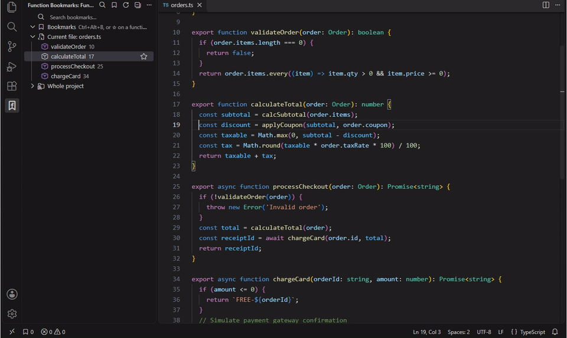
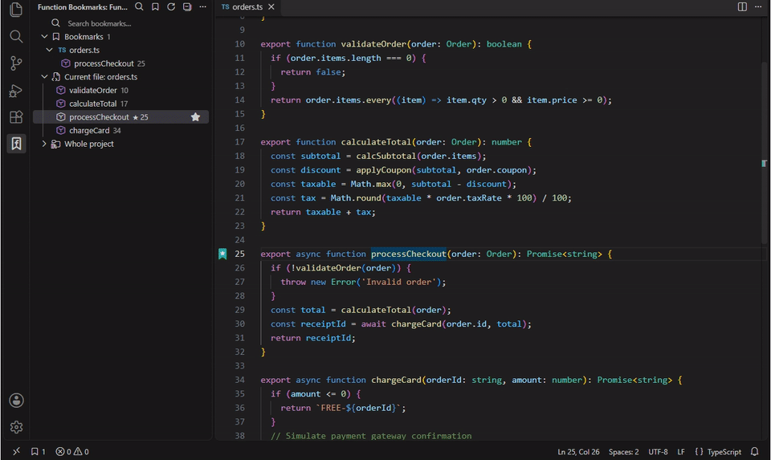
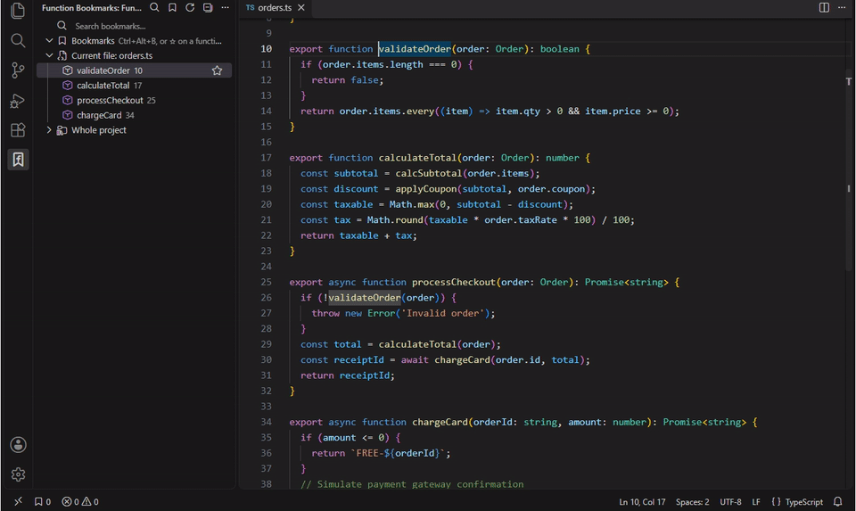

# Function Bookmarks

**Bookmark functions and lines with your own names. They stay in place after `git pull`.** Works in VS Code and Cursor.

[繁體中文說明](README.zh-TW.md)

> Preview (0.x). Feedback and bug reports are welcome in the [issue tracker](https://github.com/whlshy/function-bookmarks/issues).

## Why

Most bookmark extensions store a line number and only adjust it while you type. When a file changes on disk — `git pull`, `git checkout`, a merge, a formatter, an AI assistant writing the file — the bookmark stays on the old line number and points at the wrong code.

Function Bookmarks remembers the content around each bookmark and compares the old and new versions of the file, so bookmarks follow the code wherever it moves.

## Features

### Bookmarks that follow the code

- `Alt+Shift+B B` (or right-click a line number) — on the line with a function's name it bookmarks the **function**, anywhere else the **line**
- Follows edits, `git pull`, branch switches, merges, stashes, formatters, scripts and AI edits — even for files that are not open
- A bookmark that cannot be found (or sits inside a merge conflict) is marked *needs checking*; put it back with **Move Bookmark to Cursor**
- **Branch aware**: each branch remembers its own positions; bookmarks on code that is not on the current branch wait until you switch back; a bookmark can belong to one branch only
- Function bookmarks follow functions by name, and stay attached even after a function is renamed



### Organize and jump

- Names, **tags**, multi-line **Markdown notes** (shown on hover)
- **Numbered bookmarks**: `Alt+Shift+B Shift+1`–`9` sets a number on the current line, `Alt+Shift+B 1`–`9` jumps to it; step through numbered bookmarks in order with **Tour: Next / Previous Numbered Bookmark**
- **Colors** for bookmarks and tags — the gutter icon and side bar follow
- The bookmark name shown faintly at the end of the line
- **Search** from the first row of the side bar (`Alt+Shift+B F`): the bookmarks are filtered as you type; `#tag` and `@source` narrow it down
- Next / previous (`Alt+Shift+B .` / `Alt+Shift+B ,`), quick search (`Alt+Shift+B /`), group by file, tag or source
- **Hide bookmark icons temporarily** (to set breakpoints) from the side bar's `…` menu
- Status bar: bookmarks in the current file; click to search



### Function list

- The functions of the current file in the side bar, a **Whole project** browser, and **Search Functions**
- **Display names** (`Alt+Shift+B R` in the editor, `F2` in the side bar) for bookmarked functions without changing the code; hover to see the original name
- Event listeners and requests (`.on('click')`, `$.ajax`, `fetch`) are listed too
- **Your own detection rules** with regular expressions; **Test Detection Rules on This File** shows what each rule finds
- Works out of the box for most common languages, no language extension needed; others fall back to the language server



### Share

- **Export** bookmarks to a file or the clipboard, or as a Markdown walkthrough document, Markdown table, or CSV
- **Import** a colleague's bookmarks with a source note — they land on the right lines even if your copy of the files is different (no git needed)
- Filter and group by source; others' bookmarks are purple
- Coming from **Bookmarks (alefragnani)**? *Import Bookmarks…* reads its `.vscode/bookmarks.json` (turn on `bookmarks.saveBookmarksInProject` there first)

## Keyboard shortcuts

| Shortcut (Win / Linux) | macOS | Action |
|---|---|---|
| `Alt+Shift+B B` | `Ctrl+Shift+B B` | Add / remove a bookmark (function or line) |
| `Alt+Shift+B Shift+B` | `Ctrl+Shift+B Shift+B` | Add a named bookmark |
| `Alt+Shift+B R` | `Ctrl+Shift+B R` | Rename the bookmark at the cursor |
| `Alt+Shift+B .` / `Alt+Shift+B ,` | `Ctrl+Shift+B .` / `Ctrl+Shift+B ,` | Next / previous bookmark |
| `Alt+Shift+B /` | `Ctrl+Shift+B /` | Search bookmarks |
| `Alt+Shift+B F` | `Ctrl+Shift+B F` | Focus bookmark search bar |
| `Alt+Shift+B Shift+1`–`9` | `Ctrl+Shift+B Shift+1`–`9` | Set / remove number 1–9 on this line |
| `Alt+Shift+B 1`–`9` | `Ctrl+Shift+B 1`–`9` | Go to bookmark 1–9 |
| `F2` (side bar) | `F2` (side bar) | Rename bookmark or display name |

## Settings

**Bookmarks**

| Setting | Default | Description |
|---|---|---|
| `functionBookmarks.bookmarks.onLineDelete` | `moveToNext` | When a bookmarked line is deleted: `moveToNext`, `markLost` or `remove` |
| `functionBookmarks.bookmarks.autoNumber` | `false` | Give new bookmarks the next free number |
| `functionBookmarks.bookmarks.showLabelAtLineEnd` | `true` | Show the bookmark name at the end of the line |
| `functionBookmarks.statusBar.enabled` | `true` | Show bookmark count in the status bar |
| `functionBookmarks.hover.enabled` | `true` | Popup on function names to add a bookmark, rename, edit the note |
| `functionBookmarks.followCursor` | `true` | Highlight the function under the cursor in the side bar |

**Notes**

| Setting | Default | Description |
|---|---|---|
| `functionBookmarks.notes.closeOnSave` | `true` | Close the note editor and preview tabs after saving |

**Function detection**

| Setting | Default | Description |
|---|---|---|
| `functionBookmarks.detection.source` | `rules` | `rules`, `languageServer` or `both` |
| `functionBookmarks.detection.rules` | `[]` | Your own rules; the same `id` overrides a built-in rule |
| `functionBookmarks.detection.disabledRules` | `["html-id"]` | Built-in rule IDs to turn off |
| `functionBookmarks.detection.templateFiles` | `["**/templates/**"]` | Where the template rules apply |

**Whole project**

| Setting | Default | Description |
|---|---|---|
| `functionBookmarks.project.include` | `**/*.{ts,tsx,…,py,html,md}` | Files listed under Whole project and used by search |
| `functionBookmarks.project.exclude` | `node_modules`, `.venv`, `dist`, … | Excluded from Whole project and search |

**Storage and sharing**

| Setting | Default | Description |
|---|---|---|
| `functionBookmarks.storage` | `file` | Default for all workspaces: `file` (`.vscode/function-bookmarks.json`, kept out of git through `.git/info/exclude`) or `workspaceState`. To use a different one for a single workspace, run **Choose Bookmark Storage for This Workspace…** |
| `functionBookmarks.authorName` | git `user.name` | Your name in exported bookmarks |

### Example rule

```jsonc
"functionBookmarks.detection.rules": [
  {
    "id": "lua-function",
    "languages": ["lua"],
    "pattern": "^[ \\t]*(?:local[ \\t]+)?function[ \\t]+(?<name>[\\w.:]+)",
    "kind": "function",
    "body": "end"
  }
]
```

`body` decides how the end of a symbol is found: `brace`, `indent`, `pair` (with `end`), `line`, `embedded` (with `end` and `embeddedLanguage`), `end` or `statement`. Run **Test Detection Rules on This File** to see what each rule finds.

## Multi-root workspaces and remote development

Each workspace folder keeps its own bookmarks file with relative paths. The extension runs where your files are (`extensionKind: workspace`), so it works over SSH, WSL and Dev Containers.

## Privacy

This extension does not collect or send any data. Bookmarks are stored in your workspace (`.vscode/function-bookmarks.json`) or in the editor's workspace storage.

## License

[MIT](LICENSE)
