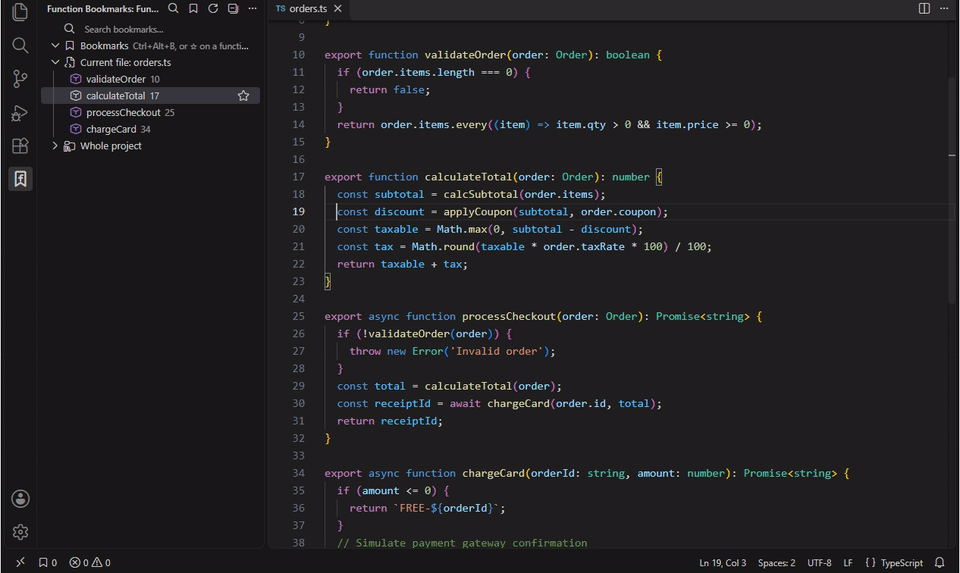
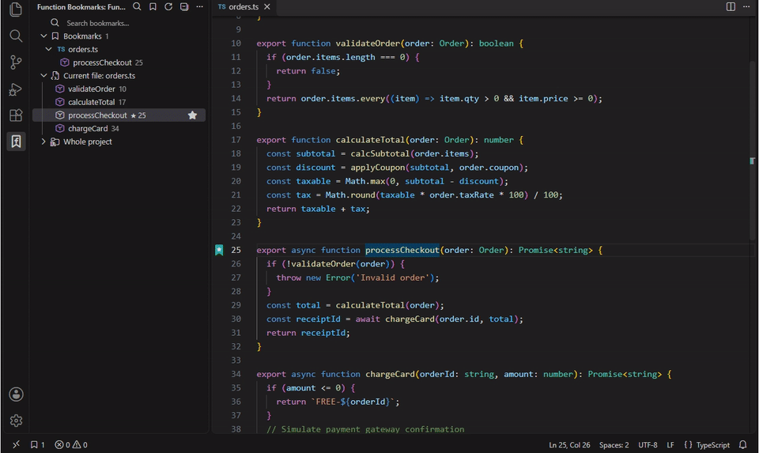
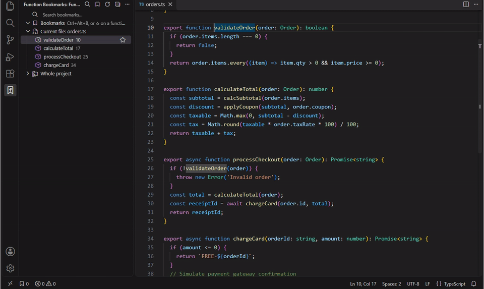

# Function Bookmarks（函式書籤）

**替函式和程式碼行加上自己命名的書籤，`git pull` 之後也不會跑掉。** VS Code 與 Cursor 都能使用。

[](https://marketplace.visualstudio.com/items?itemName=whlshy.function-bookmarks) [](https://open-vsx.org/extension/whlshy/function-bookmarks) [](https://github.com/whlshy/function-bookmarks/actions/workflows/ci.yml) [](LICENSE) [](https://ko-fi.com/whlshy)

[English](README.md) · 繁體中文 · [更新紀錄](CHANGELOG.md)

> 預覽版（0.x）。歡迎到 [問題回報](https://github.com/whlshy/function-bookmarks/issues) 提供意見或回報問題。

## 為什麼要做這個套件

多數書籤套件只記行號，而且只在你打字時調整。檔案在磁碟上被改掉時（`git pull`、`git checkout`、合併、格式化工具、AI 助手直接寫檔），書籤還停在原本的行號，指到錯的程式碼。

Function Bookmarks 會記住每個書籤附近的內容，比對檔案修改前後的差異，讓書籤跟著程式碼移動。

## 功能

### 跟著程式碼走的書籤

- `Alt+Shift+B B`（或在行號上按右鍵）：在函式名稱那一行會加入**函式書籤**，其他行則加入**行號書籤**
- 編輯、`git pull`、切換分支、合併、stash、格式化工具、腳本、AI 改檔都會跟著移動，沒開著的檔案也一樣
- 找不到位置的書籤（或落在合併衝突範圍內）會標成「需確認」，可用「把書籤移到游標所在的行」放回去
- **依分支追蹤**：每個分支記住各自的位置；程式碼不在目前分支時，書籤會等你切回去再出現；書籤也可設成只屬於某個分支
- 函式書籤以名稱追蹤，就算函式改名也能自動跟上



### 整理與跳轉

- 名稱、**標籤**、多行 **Markdown 備註**（滑鼠移上去顯示）
- **數字書籤**：`Alt+Shift+B Shift+1`～`9` 替目前這一行設定號碼，`Alt+Shift+B 1`～`9` 直接跳過去；可用「導覽：下一個／上一個編號書籤」依 1～9 順序導覽
- 書籤與標籤可以設定**顏色**，行號旁圖示與側邊欄跟著變色
- 書籤那一行的行尾淡淡顯示書籤名稱
- 側邊欄第一列就是**搜尋**（`Alt+Shift+B F`）：打字時書籤即時篩選，`#標籤`、`@來源` 可以縮小範圍
- 下一個／上一個（`Alt+Shift+B .`／`Alt+Shift+B ,`）、快速搜尋書籤（`Alt+Shift+B /`），可依檔案、標籤或來源分組
- 側邊欄「…」選單可**暫時隱藏書籤圖示**（方便設中斷點）
- 狀態列顯示目前檔案的書籤數，點一下搜尋書籤



### 函式列表

- 側邊欄列出目前檔案的函式，還有「整個專案」與「搜尋函式」
- 替已加書籤的函式**自訂顯示名稱**（編輯器內 `Alt+Shift+B R`，側邊欄 `F2`），不改程式碼；滑鼠移上去看原本的名稱
- 事件監聽與請求（`.on('click')`、`$.ajax`、`fetch`）也會列出
- 可用正規表示式**自訂偵測規則**；「在這個檔案測試偵測規則」會標出每條規則抓到什麼
- 大多數常用語言不必另外安裝語言擴充套件就能使用；其他語言改用語言伺服器



### 分享

- **匯出**書籤成檔案或複製到剪貼簿，也可輸出成導讀文件（Markdown）、Markdown 表格或 CSV
- **匯入**同事的書籤並加上來源註記；就算你的檔案內容和對方不同，也會放在正確的行（不需要 git）
- 可依來源篩選、分組；別人的書籤是紫色
- 從 **Bookmarks（alefragnani）** 換過來？「匯入書籤…」可以直接讀它的 `.vscode/bookmarks.json`（請先在該套件開啟 `bookmarks.saveBookmarksInProject`）

## 快捷鍵

| 快捷鍵（Win / Linux） | macOS | 功能 |
|---|---|---|
| `Alt+Shift+B B` | `Ctrl+Shift+B B` | 加入／移除書籤（函式或行） |
| `Alt+Shift+B Shift+B` | `Ctrl+Shift+B Shift+B` | 加入有名稱的書籤 |
| `Alt+Shift+B R` | `Ctrl+Shift+B R` | 重新命名游標所在的書籤 |
| `Alt+Shift+B .`／`Alt+Shift+B ,` | `Ctrl+Shift+B .`／`Ctrl+Shift+B ,` | 下一個／上一個書籤 |
| `Alt+Shift+B /` | `Ctrl+Shift+B /` | 搜尋書籤 |
| `Alt+Shift+B F` | `Ctrl+Shift+B F` | 移到書籤搜尋列 |
| `Alt+Shift+B Shift+1`～`9` | `Ctrl+Shift+B Shift+1`～`9` | 在這一行設定／移除 1～9 號 |
| `Alt+Shift+B 1`～`9` | `Ctrl+Shift+B 1`～`9` | 跳到 1～9 號書籤 |
| `F2`（側邊欄） | `F2`（側邊欄） | 重新命名書籤或顯示名稱 |

## 設定

**書籤**

| 設定 | 預設 | 說明 |
|---|---|---|
| `functionBookmarks.bookmarks.onLineDelete` | `moveToNext` | 書籤那一行被刪掉時：`moveToNext`（移到下一行）、`markLost`（標成需確認）、`remove`（移除） |
| `functionBookmarks.bookmarks.autoNumber` | `false` | 新增的書籤自動給下一個空號 |
| `functionBookmarks.bookmarks.showLabelAtLineEnd` | `true` | 在行尾顯示書籤名稱 |
| `functionBookmarks.statusBar.enabled` | `true` | 在狀態列顯示書籤數 |
| `functionBookmarks.hover.enabled` | `true` | 滑鼠移到函式名稱時顯示加入書籤、改名、編輯備註的提示 |
| `functionBookmarks.followCursor` | `true` | 側邊欄標示游標所在的函式 |

**備註**

| 設定 | 預設 | 說明 |
|---|---|---|
| `functionBookmarks.notes.closeOnSave` | `true` | 備註存檔後自動關閉編輯與預覽分頁 |

**函式偵測**

| 設定 | 預設 | 說明 |
|---|---|---|
| `functionBookmarks.detection.source` | `rules` | `rules`、`languageServer` 或 `both` |
| `functionBookmarks.detection.rules` | `[]` | 自訂規則；`id` 相同會取代內建規則 |
| `functionBookmarks.detection.disabledRules` | `["html-id"]` | 要關閉的內建規則 ID |
| `functionBookmarks.detection.templateFiles` | `["**/templates/**"]` | template 規則套用的範圍 |

**整個專案**

| 設定 | 預設 | 說明 |
|---|---|---|
| `functionBookmarks.project.include` | `**/*.{ts,tsx,…,py,html,md}` | 「整個專案」與搜尋要列出的檔案 |
| `functionBookmarks.project.exclude` | `node_modules`、`.venv`、`dist`… | 「整個專案」與搜尋要排除的檔案 |

**儲存與分享**

| 設定 | 預設 | 說明 |
|---|---|---|
| `functionBookmarks.storage` | `file` | 所有專案的預設：`file`（`.vscode/function-bookmarks.json`，透過 `.git/info/exclude` 排除於 git 之外）或 `workspaceState`。要讓單一專案不同，請執行「**選擇這個專案的書籤存放位置…**」 |
| `functionBookmarks.authorName` | git `user.name` | 匯出書籤時的名稱 |

### 自訂規則範例

```jsonc
"functionBookmarks.detection.rules": [
  {
    "id": "lua-function",
    "languages": ["lua"],
    "pattern": "^[ \\t]*(?:local[ \\t]+)?function[ \\t]+(?<name>[\\w.:]+)",
    "kind": "function",
    "body": "end"
  }
]
```

`body` 決定怎麼找到結尾：`brace`、`indent`、`pair`（搭配 `end`）、`line`、`embedded`（搭配 `end` 與 `embeddedLanguage`）、`end` 或 `statement`。執行「在這個檔案測試偵測規則」可以看到每條規則抓到什麼。

## 多資料夾工作區與遠端開發

每個工作區資料夾各自一份書籤檔，使用相對路徑。套件在檔案所在的地方執行（`extensionKind: workspace`），所以 SSH、WSL、Dev Container 都能用。

## 隱私

本套件不收集、也不傳送任何資料。書籤存在你的專案（`.vscode/function-bookmarks.json`）或編輯器的工作區儲存空間。

## 授權

[MIT](LICENSE)
